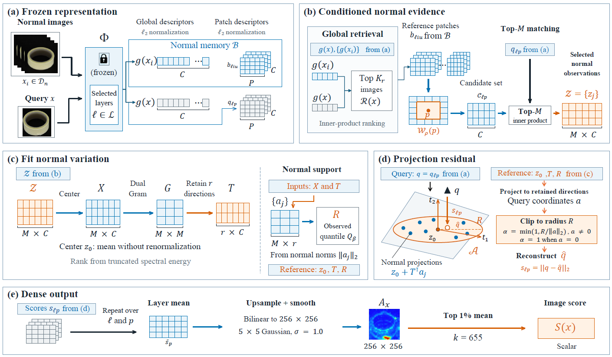

# LFR — Locally Fitted References for Training-Free Industrial Anomaly Localization

Reference implementation of **LFR** (*Locally Fitted Reference*) and its **PNR**
(*Perpendicular Normal Residual*) readout, for training-free multi-class
industrial anomaly detection and localization.

The method never trains a detector. It freezes a pretrained vision encoder,
stores the anomaly-free training descriptors once as a *normal memory*, and at
test time fits a small reference model **locally** — around the location the
query patch actually sits in, conditioned on retrieved normal evidence — and
scores the query by how far it falls outside that local reference.

<p align="center">
  
</p>

*(a) frozen representation → (b) conditioned normal evidence → (c) locally fitted
normal support $(z_0, T, R)$ → (d) clipped projection residual → (e) dense output
and top-1 % image score.*

---

## Main results

Multi-class anomaly detection and localization (%). **Image**: I-AUROC / I-AP /
I-F1-max; **pixel**: P-AUROC / P-AP / P-F1-max / AUPRO. $\dagger$ marks published
results under original protocols; *rerun* identifies evaluations performed in
this work. **Bold** identifies the best result among the training-free rows.
Real-IAD scores are rounded to one decimal; paired changes use unrounded
category means.

| Method | MVTec-AD Image | MVTec-AD Pixel | VisA Image | VisA Pixel | Real-IAD Image | Real-IAD Pixel |
|---|---|---|---|---|---|---|
| *Training-based* | | | | | | |
| RD4AD$^\dagger$ | 94.6 / 96.5 / 95.2 | 96.1 / 48.6 / 53.8 / 91.1 | 92.4 / 92.4 / 89.6 | 98.1 / 38.0 / 42.6 / 91.8 | 82.4 / 79.0 / 73.9 | 97.3 / 25.0 / 32.7 / 89.6 |
| UniAD$^\dagger$ | 96.5 / 98.8 / 96.2 | 96.8 / 43.4 / 49.5 / 90.7 | 88.8 / 90.8 / 85.8 | 98.3 / 33.7 / 39.0 / 85.5 | 83.0 / 80.9 / 74.3 | 97.3 / 21.1 / 29.2 / 86.7 |
| SimpleNet$^\dagger$ | 95.3 / 98.4 / 95.8 | 96.9 / 45.9 / 49.7 / 86.5 | 87.2 / 87.0 / 81.8 | 96.8 / 34.7 / 37.8 / 81.4 | 57.2 / 53.4 / 61.5 | 75.7 / 2.8 / 6.5 / 39.0 |
| DeSTSeg$^\dagger$ | 89.2 / 95.5 / 91.6 | 93.1 / 54.3 / 50.9 / 64.8 | 88.9 / 89.0 / 85.2 | 96.1 / 39.6 / 43.4 / 67.4 | 82.3 / 79.2 / 73.2 | 94.6 / 37.9 / 41.7 / 40.6 |
| GeneralAD$^\dagger$ | 95.4 / 98.5 / 95.9 | 97.1 / 46.0 / 50.6 / 87.0 | 87.4 / 87.3 / 82.0 | 96.5 / 35.3 / 38.7 / 81.9 | 57.5 / 53.6 / 61.6 | 76.5 / 4.8 / 7.9 / 40.8 |
| DiAD$^\dagger$ | 97.2 / 99.0 / 96.5 | 96.8 / 52.6 / 55.5 / 90.7 | 86.8 / 88.3 / 85.1 | 96.0 / 26.1 / 33.0 / 75.2 | 75.6 / 66.4 / 69.9 | 88.0 / 2.9 / 7.1 / 58.1 |
| MambaAD$^\dagger$ | 98.6 / 99.6 / 97.8 | 97.7 / 56.3 / 59.2 / 93.1 | 94.3 / 94.5 / 89.4 | 98.5 / 39.4 / 44.0 / 91.0 | 86.3 / 84.6 / 77.0 | 98.5 / 33.0 / 38.7 / 90.5 |
| OmiAD$^\dagger$ | 98.8 / 99.7 / 98.5 | 97.7 / 52.6 / 56.7 / 93.2 | 95.3 / 96.0 / 91.2 | 98.9 / 40.4 / 44.1 / 89.2 | 90.1 / 88.6 / 82.8 | 98.9 / 37.7 / 42.6 / 93.1 |
| Dinomaly$^\dagger$ | 99.6 / 99.8 / 99.0 | 98.4 / 69.3 / 69.2 / 94.8 | 98.7 / 98.9 / 96.2 | 98.7 / 53.2 / 55.7 / 94.5 | 89.3 / 86.8 / 80.2 | 98.8 / 42.8 / 47.1 / 93.9 |
| *Training-free* | | | | | | |
| SubspaceAD (rerun) | 98.26 / 99.06 / 97.10 | 97.82 / 71.92 / 68.55 / 93.22 | 95.51 / 95.61 / 92.12 | 98.44 / 53.28 / 56.10 / 92.95 | – | – |
| RAD (rerun) | 99.51 / 99.83 / 98.87 | 98.47 / 75.57 / 71.29 / 95.80 | 97.42 / 97.24 / 95.21 | 99.11 / 55.33 / 57.43 / 94.58 | 92.0 / **89.9** / **83.0** | 99.1 / 52.2 / 53.1 / 96.1 |
| **LFR (ours)** | **99.57 / 99.87 / 99.05** | **98.73 / 77.44 / 72.63 / 96.29** | **97.59 / 97.32 / 95.42** | **99.25 / 56.60 / 58.06 / 95.40** | **92.1** / 89.7 / 82.9 | **99.2 / 53.0 / 53.7 / 96.5** |

*Protocol notes.* SubspaceAD reruns use the authors' code with the same frozen
DINOv3 backbone and input resolution as LFR. RAD (rerun) and LFR additionally
share normal memory, retrieval pools, post-processing and evaluator. Dashes
indicate methods not evaluated on Real-IAD. The Real-IAD RAD–LFR pair uses the
same $512\times512$ image/mask copy and $\rho = 4$, differing from the published
RAD protocol.

The LaTeX source of this table is in [`docs/main_results.tex`](docs/main_results.tex).

---

## 1. What this repository is

The complement of the paper, not a framework:

* **`curvot_rad.py`** — the single entry point. One invocation evaluates one or
  more classes end-to-end and writes `metrics.json`.
* **`curvot_utils.py`** — the two operators the paper contributes: the local fit
  of the normal support, and the clipped perpendicular residual readout.
* **`baseline_scores.py`** — four training-free reference constructions
  (SubspaceAD, ANoCo, PaDiM, PatchCore) re-expressed under one interface, so
  they can be run on *identical* features, memory, retrieval pool and evaluator.
* **`build_*_bank_multilayer.py`** — normal-memory construction.
* **`tools/`** — table generators and audits. They read run outputs and print the
  paper's tables; they never measure anything themselves.
* **`scripts/`** — portable drivers that issue the exact command lines used for
  the paper, with machine-specific paths lifted into environment variables.
* **Root-level `test_*.py` / `bench_*.py`** — the equivalence harnesses quoted in
  the paper (bit-exactness of the radius patch, the fast-window A/B, the
  definition-level properties of the four baselines).

Datasets, checkpoints and built banks are **not** included: see section 3.

---

## 2. Method at a glance

Everything below happens at test time; no gradient is ever computed.

1. **Frozen representation.** A DINOv3 ViT-B/16, frozen, produces patch
   descriptors from block indices 3/6/9/11 (0-based) and a global `[CLS]`
   descriptor per layer. The anomaly-free training split is encoded once into a
   **normal memory** $\mathcal{B}$ (one `.pth` per dataset).
2. **Conditioned normal evidence.** For a query image, global `[CLS]`
   descriptors retrieve the $K$ nearest training images. From those, a candidate
   patch set $W_p$ is taken around the matching position, and the query patch is
   matched against it by inner product, keeping the top $M$ normal observations
   $\mathcal{Z} = \{z_j\}$ for that location.
3. **Locally fitted reference.** $\mathcal{Z}$ is centred to $X$; the truncated
   spectral energy of the dual Gram matrix of $X$ fixes how many directions $r$
   are retained, giving a tangent span $T$. The centre $z_0$ and the observed
   quantile of the retained normal coordinates together give the support radius
   $R$. The triple $(z_0, T, R)$ **is** the reference — it is fitted, it is
   local, and it is what the query is measured against.
4. **Perpendicular normal residual (PNR).** The query is projected onto the
   support, the projection coefficient is clipped by $\alpha = \min(1, R/\lVert a
   \rVert_2)$ (so a query far outside the radius is pulled back to the support
   boundary instead of being chased to a far-away affine point), and the score is
   $s = \lVert q - \hat q \rVert_2$ — the component of the query that the local
   normal reference cannot explain.
5. **Dense output.** Scores are repeated over the $(\ell, p)$ grid, mean-fused
   across layers, bilinearly upsampled to $256\times256$, smoothed with a
   $5\times5$ Gaussian ($\sigma=1$), and the image score is the mean of the top
   1 % of the map.

Two knobs matter and both are mild: how much local variation the reference is
allowed to absorb ($d_{\max}$, the retained-dimension cap) and how wide the
support is ($\beta$, the quantile that sets $R$). The paper's default is
`--lonm_dmax 4 --lonm_quadratic 0 --lonm_trust 0.9 --lonm_M 24`.

### 2.1 Terminology: why the code says `lonm`

The paper calls the method **LFR** and the readout **PNR**. The code was written
under the working name *CurvOT-RAD*, and the operator had the working name
*LONM*. The CLI flags, the output filename and the internal helper names
therefore keep the older spelling on purpose — renaming them would change the
`args` block recorded inside every `metrics.json` and would invalidate every
command line in the paper's reproducibility notes. The mapping is:

| in the code | in the paper |
|---|---|
| `curvot_rad.py` | the LFR entry point |
| `--use_lonm 1` | run LFR (vs. RAD with `--use_lonm 0`) |
| `curvot_utils.py`, `lonm_*` helpers | the LFR fit |
| `lonm_score` | the PNR residual $s=\lVert q-\hat q\rVert_2$ |

`curvot_rad.py` also carries switches from an earlier research line that is not
part of this paper — most visibly `--use_aptr` (partial-transport re-ranking).
They all default to `0`, no command in `scripts/` uses them, and the results here
never depend on them. They are left in place only because removing them would
change the flag table and with it the recorded `args` blocks.

---

## 3. Installation and data

### 3.1 Environment

```bash
conda create -n lfr python=3.11 -y
conda activate lfr
pip install -r requirements.txt
```

`requirements.txt` pins the versions the reported numbers were produced with
(python 3.11.7, torch 2.4.1 + cu118, one RTX 4090 with 24 GB). Any recent CUDA
GPU with ≥ 16 GB and any torch ≥ 2.x should work; the pins are for comparison,
not for correctness.

### 3.2 Encoder: DINOv3 ViT-B/16

The code imports `dinov3.hub.backbones.load_dinov3_model`, which is the **official
DINOv3 repository** and is not on PyPI:

```bash
git clone https://github.com/facebookresearch/dinov3.git
export PYTHONPATH="$PWD/dinov3:$PYTHONPATH"        # or install it into the env
```

Weights are gated: request access from the DINOv3 repository page (or use
Hugging Face `facebook/dinov3-vitb16-pretrain-lvd1689m`) and place the ViT-B/16
checkpoint where the drivers expect it:

```
models/dinov3_vitb16_pretrain_lvd1689m-73cec8be.pth
```

If you keep it elsewhere, export the path instead of copying:

```bash
export ENC_W=/abs/path/to/dinov3_vitb16_pretrain_lvd1689m-73cec8be.pth
```

*The encoder is never fine-tuned, and the paper's claim depends on that: every
number is produced with the backbone exactly as its authors released it.*

### 3.3 Datasets

None is redistributed here. Download each from its own source and place it under
`data/` (or point `DATA_ROOT` at wherever you keep it).

**MVTec-AD** — <https://www.mvtec.com/company/research/datasets/mvtec-ad>
(registration form; CC BY-NC-SA 4.0). Extract as-is:

```
data/mvtec-ad/
├── bottle/
│   ├── train/good/*.png
│   ├── test/<defect>/*.png
│   └── ground_truth/<defect>/*_mask.png
└── ... 15 categories
```

**VisA** — <https://github.com/amazon-science/spot-diff> (CC BY 4.0). The raw
release has its own layout; convert it to the 1-class split with the official
splitting code. Upstream RAD ships a copy of that script plus the split CSV, so
the shortest reliable route is:

```bash
git clone https://github.com/longkukuhi/RAD.git /tmp/RAD
python /tmp/RAD/prepare_data/prepare_visa.py --split-type 1cls \
    --data-folder ./VisA --save-folder ./data/VisA_pytorch \
    --split-file /tmp/RAD/prepare_data/split_csv/1cls.csv
```

(The same conversion, from the dataset authors, is in
<https://github.com/amazon-science/spot-diff> under their `prepare_data` tooling;
either invocation produces the same split.)

which yields the MVTec-shaped layout the loader expects:

```
data/VisA_pytorch/1cls/
├── candle/{train/good, test/good, test/bad, ground_truth/bad}
└── ... 12 categories
```

**Real-IAD** — <https://realiad4ad.github.io/Real-IAD/> (application form;
CC BY-NC-SA 4.0). Official tooling:
<https://github.com/Tencent/AnomalyDetection_Real-IAD>; the dataset is also on
Hugging Face as `REAL-IAD/Real-IAD`. Unpack the 1024-pixel images and the jsons
so that:

```
data/Real-IAD/
├── realiad_1024/<object>/{OK,NG}/*.jpg|*.png        # 30 objects
└── realiad_jsons/realiad_jsons/<object>.json
```

> **Use the 1024-pixel release.** The Real-IAD row of the table reflects the
> resolution of the copy that was available while the paper was written; on that
> copy the pixel-level AP / F1 sit ~1.5 pp below the published RAD protocol
> because downsampled masks have softer boundaries. Image-level AUROC and AUPRO
> are unaffected. If you reproduce on the 1024 release and see higher AP / F1,
> that is the expected direction, not a discrepancy.

### 3.4 Normal-memory banks

Built once per dataset, then reused by every run and every comparison (this is
what makes the comparison *matched*):

```bash
bash scripts/build_banks.sh mvtec      #  ~33 GiB
bash scripts/build_banks.sh visa       #  ~78 GiB
bash scripts/build_banks.sh realiad    # ~327 GiB  (see below)
```

Real-IAD's bank is ~352 GB of float32 descriptors, and the builder materialises
a full-size temporary copy first — so point `--tmp_dir` at a volume with room:

```bash
BANK_TMP=/mnt/big/bank_tmp bash scripts/build_banks.sh realiad
```

### 3.5 Telling the code where things are

Every driver reads the same variables (`scripts/common.sh`); export the ones you
need, or just use the defaults by placing files as shown above:

| variable | default | what it points at |
|---|---|---|
| `DATA_ROOT` | `./data` | dataset root |
| `BANK_DIR` | `./bank` | built banks |
| `MODEL_DIR` | `./models` | DINOv3 checkpoint |
| `ENC_W` | `$MODEL_DIR/dinov3_vitb16_pretrain_lvd1689m-73cec8be.pth` | checkpoint file |
| `OUT_DIR` | `./saved_curvot` | where `metrics.json` per run is written |
| `CACHE_MB` | `9000` | GPU bank-cache budget (MVTec-AD / VisA) |
| `BANK_TMP` | `./.bank_tmp` | scratch for the Real-IAD builder |
| `PYTHON` | `python` | interpreter to use |

---

## 4. Reproducing the results

### 4.1 Main table (MVTec-AD and VisA)

```bash
bash scripts/run_main_table.sh mvtec rad     # RAD  -> saved_curvot/mf_rad
bash scripts/run_main_table.sh mvtec lfr     # LFR  -> saved_curvot/mf_raw4
bash scripts/run_main_table.sh visa  rad     # RAD  -> saved_curvot/v3_rad
bash scripts/run_main_table.sh visa  lfr     # LFR  -> saved_curvot/v3_rawl4
```

The two arms differ by exactly one line (`scripts/common.sh`), and that line is
the whole method:

```bash
RAD_ARM="--use_lonm 0"
LFR_ARM="--use_lonm 1 --lonm_norm 1 --lonm_norm_mode raw --lonm_dmax 4 --lonm_quadratic 0"
```

Everything else — encoder, layers, memory, retrieval pool, mask, pooling,
evaluator — is identical between the two arms, which is what makes the
difference attributable to the reference construction alone.

Expected (`saved_curvot/<run>/metrics.json`, percentages):

| run | I-AUROC | I-AP | I-F1 | P-AUROC | P-AP | P-F1 | AUPRO |
|---|---|---|---|---|---|---|---|
| `mf_rad` | 99.51 | 99.83 | 98.87 | 98.47 | 75.57 | 71.29 | 95.80 |
| `mf_raw4` | 99.57 | 99.87 | 99.05 | 98.73 | 77.44 | 72.63 | 96.29 |
| `v3_rad` | 97.42 | 97.24 | 95.21 | 99.11 | 55.33 | 57.43 | 94.58 |
| `v3_rawl4` | 97.59 | 97.32 | 95.42 | 99.25 | 56.60 | 58.06 | 95.40 |

### 4.2 Real-IAD

One invocation per class (30 classes), one append-only result file per arm:

```bash
bash scripts/run_realiad_rho4.sh a    # RAD  -> exp/results_ri_a_rho4.txt
bash scripts/run_realiad_rho4.sh b    # LFR  -> exp/results_ri_b_rho4.txt
```

```bash
python tools/ri_table_rho4.py --repo . --out exp/tables/RAD_REALIAD_TABLE.md
```

Note the two arm-specific details, both commented in the script: $\rho = 4$ (the
published README prints 0 for Real-IAD, which reproduces nothing — see the table
of measurements in the script header), and the mmap launcher
`ri_launch_curvot_rad.py`, because a 352 GB checkpoint cannot be mapped privately
on a machine running with `vm.overcommit_memory=0`.

Cost: arm a ≈ 32 h, arm b ≈ 20 h (`--lonm_fast 1`, which is bit-identical to the
reference window implementation — see section 7).

### 4.3 Matched-feature baselines

```bash
bash scripts/run_matched_baselines.sh
python tools/bd_table.py
```

Runs SubspaceAD and ANoCo on both datasets under the *same* features, memory,
retrieval pool and evaluator as the RAD/LFR rows. The audit inside `bd_table.py`
refuses to print a table when two arms that should be identical differ on any
recorded field.

### 4.4 Support radius (MVTec-AD)

```bash
bash scripts/run_radius_ablation.sh
python tools/rd_radius_table.py
python tools/rd_radius_perclass.py
```

### 4.5 Radius-percentile sweep (MVTec-AD)

```bash
bash scripts/run_beta_sweep.sh
python tools/rd_beta_table.py
```

### 4.6 Everything at once

```bash
bash scripts/make_tables.sh          # all tables -> exp/tables/
bash scripts/make_tables.sh radius   # or one group
```

### 4.7 Equivalence and property tests

```bash
python test_unbounded_equiv.py       # the radius patch is bit-exact
python test_baselines.py             # definition-level properties of the 4 baselines
python test_window_fast.py           # --lonm_fast == the reference window
python bench_window_fast.py          # and how much faster it is
python tools/test_beta_table.py      # self-test of the sweep analyser
```

### Runtime budget (one RTX 4090)

| stage | cost |
|---|---|
| bank build, MVTec-AD / VisA | ~20 min / ~45 min |
| bank build, Real-IAD | ~40 min + disk |
| `run_main_table.sh mvtec {rad,lfr}` | ~25–35 min each |
| `run_main_table.sh visa {rad,lfr}` | ~1.5–2 h each |
| Real-IAD arm a / arm b | ~32 h / ~20 h |
| matched baselines (4 runs) | ~10 min each (MVTec), ~1.5–4 h each (VisA) |
| radius ablation + β sweep (10 runs) | ~25–35 min each |

---

## 5. Repository layout

```
.
├── curvot_rad.py                  # entry point: evaluate one dataset / class
├── curvot_utils.py                # LFR fit + PNR readout (the contributed operators)
├── baseline_scores.py             # SubspaceAD / ANoCo / PaDiM / PatchCore, matched interface
├── rad_mvtec_visa_3dadam.py       # bank cache, loader, positional patch scoring
├── dataset.py                     # MVTec / VisA / Real-IAD loaders and layout probing
├── utils.py                       # metrics: AUPRO (PRO), F1-max, Gaussian kernel
├── cu_ref.py                      # pre-patch reference copy of the window code
├── build_bank_multilayer.py       # normal memory: MVTec-AD, VisA
├── build_realiad_bank_multilayer.py  # normal memory: Real-IAD (disk-backed)
├── bank_builder_disk.py           # the disk-backed writer used above
├── ri_launch_curvot_rad.py        # MAP_SHARED read-only bank launcher (Real-IAD)
├── ri_sharedbank.py               # the loader that launcher installs
├── test_baselines.py              # property tests for the four baselines
├── test_unbounded_equiv.py        # bit-exactness of the radius patch
├── test_window_fast.py            # --lonm_fast equivalence
├── bench_window_fast.py           # --lonm_fast speed measurement
├── scripts/                       # portable drivers (see section 4)
├── tools/                         # table generators + audits (see section 4)
├── refs/                          # published reference column used by one table
├── figures/framework.png
├── docs/main_results.tex          # LaTeX source of the table above
├── docs/CODE_FINGERPRINTS.txt     # md5 of every file + what "frozen" means here
├── exp/                           # run logs and generated tables (git-ignored)
├── bank/  data/  models/          # you fill these (git-ignored)
└── saved_curvot/                  # run outputs (git-ignored)
```

Every run writes `saved_curvot/<name>/metrics.json` with three keys — `args`
(the full argument dictionary of that run), `mean` (the seven headline metrics
plus `mean_normal_score`), and `per_class` (the same per category). The tables in
the paper are all derived from these files, and every generator in `tools/`
refuses to print a table if a per-class mean disagrees with the stored mean.

---

## 6. How to read the numbers

Three things are worth knowing before comparing against the table.

**The advantage is a localization effect.** Against the two closest training-free
constructions, LFR wins every *pixel-level* indicator on both datasets
(pixel-AP +5.52 / +5.22 pp on MVTec-AD and +3.32 / +4.89 pp on VisA against
SubspaceAD / ANoCo). At the *image* level the margin is much thinner: ANoCo's
image-AP on MVTec-AD is 0.19 pp away (8 wins / 6 ties / 1 loss, with half the
categories tied below the 0.005 pp print resolution), and on VisA the image-level
difference does not have a consistent sign. Image-level superiority is therefore
**not** claimed in either direction.

**The radius is a sensitivity bound, not an accuracy knob.** Sweeping $\beta$
over nine points (0.9 → 0.1, i.e. the 22nd down to the 3rd of 24 retained
coordinates) moves the pixel-AP by 0.09 pp in total; no interior optimum exists,
and the unbounded arm is the maximum on 7 of 7 metrics. What the radius does buy
is a *bounded* error: the projection coefficient is clipped, and that bound is
what makes the score interpretable as "distance outside the observed normal
support" rather than "distance to an extrapolated affine point".

**Real-IAD image-level is where LFR does not improve.** Relative to RAD on the
same copy, image-level AUROC / F1 are flat, image-AP is slightly lower, and the
gains are again pixel-level (pixel-AP +0.84 pp, 24 of 30 categories). The
reproduction gap against the published RAD numbers is larger than the gain, so
the table prints three columns rather than claiming to beat the paper.

---

## 7. Code identity and equivalence evidence

`docs/CODE_FINGERPRINTS.txt` lists the md5 of every shipped file. Every runtime
module is byte-identical to the revision on the training box that produced the
numbers; the drivers in `scripts/` are new but contain no arithmetic of their own
— they only issue command lines — and exactly one file carries a packaging edit,
marked in the source with a `PACKAGING EDIT` banner (`tools/dump_defaults.py`,
whose source path is now resolved relative to the repository instead of being
hard-coded). So "the released code is the code that ran" is checkable rather than
asserted.

Two equivalences are load-bearing and both are shipped as tests:

* **`--lonm_fast 1`** rewrites the candidate-collection loop (one `bmm` plus a
  gather, instead of one memory read per offset — a 25.9× window speedup, 10.2×
  on the real pipeline, and the reason Real-IAD arm b takes 20 h instead of 32).
  `test_window_fast.py` and `p_fastwin_diff.py` establish that the scores are
  identical to the reference implementation: image-level metrics bit-identical,
  `lonm_score` within 5.96e-08.
* **`--lonm_clipstat 1`** only counts how often the radius clips. It is
  numerically inert, which is what lets the radius arms and the main-table arms
  be compared field by field; `test_unbounded_equiv.py` verifies it.

One caveat the paper also carries: `AUPRO` is not reproducible to four decimals
across implementations, because it is a quantile-averaged curve and a 1e-7 change
in a score can flip a threshold's rank. Image-level metrics and P-AUROC / P-AP /
P-F1 are stable to four decimals.

---

## 8. Licence and acknowledgements

**No licence is granted yet, and that is deliberate rather than an oversight.**
Part of the runtime in this repository descends from the RAD codebase, which as
of this writing ships without a licence file; those files therefore remain the
property of their authors and we are not in a position to relicense them. We are
seeking the upstream authors' permission, and will attach a licence once it
exists. Until then, please treat the code as reserved for reviewing and
reproducing the paper, and see [`docs/RELEASE_NOTES.md`](docs/RELEASE_NOTES.md)
for the per-file provenance and the options.

No dataset or checkpoint is redistributed here. Their licences apply to anything
you download, and none of the three permits commercial use: MVTec-AD — CC
BY-NC-SA 4.0; Real-IAD — CC BY-NC-SA 4.0; VisA — CC BY 4.0.

This work builds on the RAD codebase and on DINOv3. Please cite those alongside
the paper:

* **RAD** — *Is Task-Specific Training Necessary for Anomaly Detection?*
  (Retrieval-based Anomaly Detection), ICML 2026 —
  <https://github.com/longkukuhi/RAD>. This is the frozen-feature, memory-based
  retrieval baseline this work starts from; the normal-memory construction, the
  loaders and the metric code here are derived from it. Note that RAD is *not*
  reverse distillation — RD4AD is a separate, trained baseline in the table.
* **DINOv3** — Siméoni et al., *DINOv3*, Meta AI (the frozen encoder).

---

